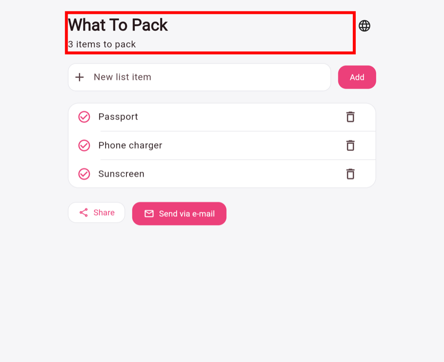
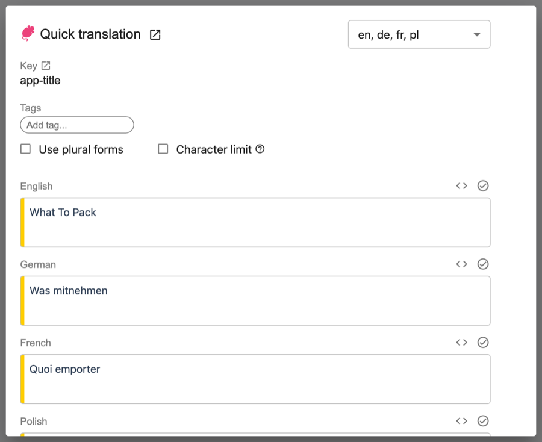
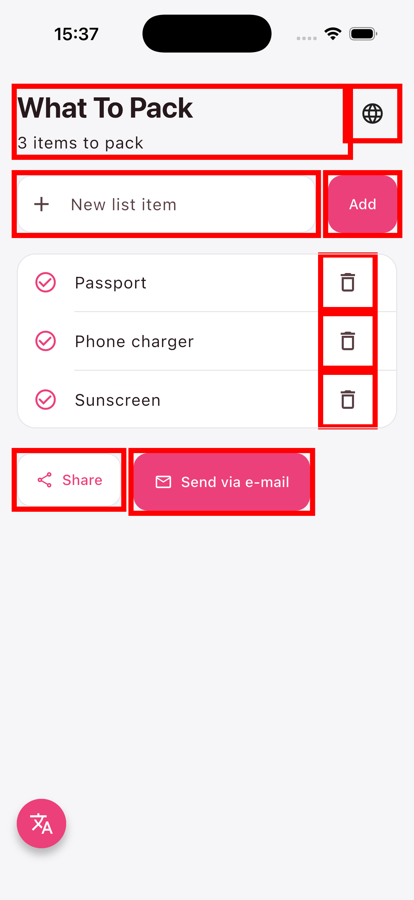

<!-- prettier-ignore -->
<div align="center">

<a href="https://tolgee.io"></a>

# Tolgee Flutter SDK

*Localize your Flutter app with Tolgee and edit texts right in the running app*

[](https://github.com/tolgee/flutter-sdk/actions/workflows/test.yml)
[](https://pub.dev/packages/tolgee)
[](https://pub.dev/packages/tolgee_in_context)
[](LICENSE)
[](https://join.slack.com/t/tolgeecommunity/shared_invite/zt-2zp55d175-_agXTfKKVbf1BYXlKlmwbA)

[Features](#features) • [Getting started](#getting-started) • [In-context editing](#in-context-editing) • [Release builds](#release-builds) • [Example](#example) • [Resources](#resources)





</div>

[Tolgee](https://tolgee.io) is an open-source localization platform. This repository holds its
Flutter packages: `tolgee` loads and shows your translations, and `tolgee_in_context` lets you
click a text in the running app and edit it in the same editor that Tolgee's JavaScript SDKs use.

## Features

- **Live texts in dev builds.** Texts come straight from your Tolgee project, so you see a change
  without exporting files or rebuilding the app.
- **In-context editing.** Alt + click a text on web and macOS (Option + click on a Mac), or tap it on iOS and Android. The
  editor shows all languages, plural forms and tags, and a save shows up in the app at once.
- **Safe release builds.** Release builds load texts from the Tolgee CDN, from files bundled with
  the app, or both. They never contain your API key or the editor.
- **ICU message format**, including plurals and parameters.
- **Language fallbacks.** The app starts in the device language (`pt-BR`, then `pt`, then another
  `pt` region, then the base language), and a missing text falls back to the base language.

## Getting started

You need a [Tolgee](https://app.tolgee.io) project and an API key for it (Project settings →
API keys).

1. Add both packages:
   ```yaml
   dependencies:
     tolgee: ^2.0.0
     tolgee_in_context: ^2.0.0
   ```

2. Initialize Tolgee and pass its delegates to your app:
   ```dart
   import 'package:flutter/material.dart';
   import 'package:tolgee/tolgee.dart';
   import 'package:tolgee_in_context/tolgee_in_context.dart';

   Future<void> main() async {
     TolgeeInContext.install();
     await Tolgee.init();
     runApp(const MyApp());
   }

   class MyApp extends StatelessWidget {
     const MyApp({super.key});

     @override
     Widget build(BuildContext context) {
       return MaterialApp(
         localizationsDelegates: Tolgee.localizationDelegates,
         supportedLocales: Tolgee.supportedLocales,
         locale: Tolgee.currentLocale,
         home: Scaffold(
           appBar: AppBar(title: const TranslationText('app-title')),
           body: TranslationWidget(
             builder: (context, tr) => Text(tr('items-count', {'count': 3})),
           ),
         ),
       );
     }
   }
   ```

3. Put the API key into `tolgee.env` and run the app with it:
   ```
   TOLGEE_API_KEY=tgpak_...
   TOLGEE_API_URL=https://app.tolgee.io
   ```
   ```bash
   flutter run --dart-define-from-file=tolgee.env
   ```

> [!WARNING]
> Don't commit `tolgee.env`, add it to `.gitignore`. Tolgee reads the key only in debug and
> profile builds, so a release build never contains it, even when the build command passes it.

## In-context editing

| Platform | How to edit |
|---|---|
| Web, macOS | Hold Alt (Option on a Mac) and move the mouse over a text to see a red border. Alt + click (Option + click) opens the editor. |
| iOS, Android | Tap the Tolgee bubble to switch editing on. Every text gets a red border, and a tap opens the editor. |
| Windows, Linux | Not available, the app works as usual. |

If a widget shows several keys, a menu lets you pick one. Editing works only while texts come
from the Tolgee API, so `TolgeeInContext.install()` does nothing in release builds.

See the [`tolgee_in_context` README](packages/tolgee_in_context/README.md) for the limits on
each platform.

## Release builds

Release builds don't use the API. Pick where their texts come from:

- **Tolgee CDN:** `Tolgee.init(useCDN: true, cdnUrl: 'https://cdn.tolg.ee/<your-cdn-id>')`
- **Bundled files:** JSON exported from Tolgee in `lib/tolgee/`, added to your assets
- **Both:** add `fallbackOnFail: true`, and a failed CDN request falls back to the bundled files

> [!TIP]
> Without the API, Tolgee takes the language list from the bundled file names. With the CDN
> and no bundled files, pass `availableLanguages` to `Tolgee.init`.

The [`tolgee` README](packages/tolgee/README.md#release-builds-cdn-and-bundled-files) has the
details.

## Example

The [example app](packages/tolgee/example) is a small packing list in English, German, French
and Polish, with in-context editing on web, iOS, Android and macOS.

```bash
cd packages/tolgee/example
flutter run                                    # texts from the bundled files
flutter run --dart-define-from-file=tolgee.env # live texts and in-context editing
```

## Resources

| | |
|---|---|
| [`tolgee`](packages/tolgee/README.md) | Loading, languages, fallbacks and logging |
| [`tolgee_in_context`](packages/tolgee_in_context/README.md) | In-context editing setup and limits |
| [Migrating from 1.x](packages/tolgee/doc/migrating-to-2.md) | What changed in 2.0 |
| [Tolgee docs](https://docs.tolgee.io) | The Tolgee platform |
